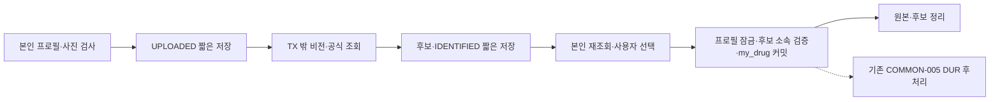

# 사진으로 약 등록 · REG-002~007 통합

## 적용과 범위

SQL 01 → 03 → 04 → **05_PHOTO_CANDIDATE_LINKS.sql**을 명시적으로 실행한 서버가 기준임. 기존 데이터는 보존하며 05 마지막 `photo_links_status=READY`를 확인함. 적용 후 16개 표·127개 열·18개 FK임. 앱이 업무 DB에 자동 적용하지 않음.

이 흐름은 사진에서 약 후보를 찾아 사용자가 선택한 약만 등록하는 기능임. 별도 대화형 약 식별 에이전트는 백로그임. 모델은 이름·제약사·각인 등 단서만 읽으며, 공식 코드·전문/일반·실제 후보는 식약처 조회 결과에서만 가져옴. 후보가 맞는지 사용자가 확인하기 전에는 등록하지 않음.

## 정식 HTTP 계약

로그인 Bearer JWT가 필요함. 경로의 프로필은 로그인 회원의 것이어야 함.

| 동작 | 경로와 입력 | 결과 |
| --- | --- | --- |
| 처방전·약봉투 식별 | `POST /api/profiles/{profileId}/photo-identifications`, multipart `kind=PRESCRIPTION` 또는 `MEDICINE_BAG`, `image` 1장 | 200, `photoId`, `photoIds`, `status`, 약별 `drugs` |
| 알약 식별 | 같은 POST, `kind=PILL`, `front`·`back` 각 1장 | 200, 대표 앞면 `photoId`, 앞뒤 `photoIds`, `candidates`, `printMatched` |
| 후보 재조회 | `GET /api/photos/{photoId}/candidates` | 저장된 공식 후보와 현재 `alreadyRegistered`를 다시 계산함 |
| 원본 확인 | `GET /api/photos/{photoId}/image` | 본인 이미지 바이트·올바른 MIME·Cache-Control no-store임 |
| 나가기·다시 찍기 | `DELETE /api/photos/{photoId}` | 204. 알약은 앞뒤 그룹을 함께 지움 |
| 선택 저장 | `POST /api/profiles/{profileId}/drugs`, 아래 JSON | 신규가 있으면201, 전부 기등록이면200. `saved`·`skipped` 목록임 |

`images` 배열 입력도 허용하지만 처방전은 정확히1장, 알약은 정확히2장이어야 함. 단일 입력과 섞거나 같은 필드를 중복한 파일을 보내면400임. 원본은 장당10MB 이하의 실제 JPEG·PNG·WEBP만 허용함. 확장자·MIME·디코딩 형식이 같아야 함. 모델에는 EXIF를 제외하고 최대2048px JPEG로 보냄. 디코딩 한도는3200만 픽셀임.

```json
{
  "source": "PRESCRIPTION_PHOTO",
  "photoId": 123,
  "items": [{"itemSeq": "공식_숫자_품목코드"}]
}
```

예시의 photoId는 설명용임. itemSeq 자리는 실제 후보의 숫자 코드로 바꿔야 함. 알약은 `PILL_PHOTO`임. 이름 검색은 `SEARCH`, `photoId` 없이 같은 items를 사용함. 같은 요청의 코드 중복은 제거하며 이미 등록된 약은 `skipped[].reason=ALREADY_REGISTERED`임. 저장 후 사진이 이미 정리됐어도 같은 요청을 다시 보내면 전부 skipped로 성공함.

새 선택 계약은 복용 일정을 자동 생성하지 않음. 현재 DB의 필수 dose_per_time에는 초기값1을 두되 날짜·시각은 NULL임. 이 값은 사진에서 읽거나 권장한 복용량이 아니며, 일정 저장 화면에서 사용자가 실제 값·기간·시각을 입력해야 함.

## 상태와 장애

- `OK`: 실제 후보가 하나 이상이며 성공 사진을 확인 완료까지 유지함. 약별 `lookup`은 OK / NOT_FOUND / FAILED로 구분함. 일부 이름 조회 실패가 나머지 후보를 없애지 않음.
- `UNREADABLE`: 처방전 글자·사진 종류·알약 수가 유효하지 않거나, 알약의 이름과 제약사를 모두 읽지 못한 경우임. 200 업무 결과이며 photoId/photoIds는 NULL임.
- `NOT_FOUND`: 읽기는 성공했으나 실제 공식 후보가 전부0건인 경우임. 200이며 사진·후보를 정리함.
- 모델 오류·전체 공식 조회 실패는503임. 파일/개수 오류400, 미로그인401, 프로필 소유권 위반403, 다른 회원의 사진은404임.
- 모델 대기 최대30초·후보 작업 최대40초·외부 작업 전체85초 예산임. 외부 작업에는 DB 쓰기를 맡기지 않아 시간 초과 후 늦은 결과가 후보를 다시 만들지 못함. 업로드·DB·HTTP 인프라까지 포함한 절대85초 보장은 아님.
- 이름은 최대10개, 이름당 후보 최대5개임. 허가08 목록/낱알03의 첫100개 결과 안에서 비교함. 알약 각인은 앞뒤를 바꾼 경우도 같은 후보로 비교함. 각인/색만으로 전체 목록을 조회하는 기능은 백로그임.
- 공식 응답의 전문/일반은 반드시 확인함. 필수 외형/성분 열에 자료가 없는 경우 `미확인`으로 표시함. 기존 drug 캐시의 상세 값을 빈 정보로 덮어쓰지 않음. 취하 여부는 후보 재조회에서 NULL일 수 있으며 확정 근거·복약 안내는 기존 공식 근거 API가 별도로 검증함.

## 저장과 정리 경계



`photo.front_photo_id`가 뒷면을 대표 앞면과 연결하며 `ocr_candidate.item_seq`가 공식 drug를 참조함. 키워드만 있던 이전 후보의 NULL 코드를 임의로 채우지 않음. 같은 프로필의 선택 등록은 프로필 행 잠금과04 복합 UNIQUE로 보호함. 후보에 없는 새 약·다른 프로필·사진 종류가 맞지 않으면 저장하지 않음.

정리 IO 실패는 이미 커밋된 약 등록 성공을 바꾸지 않음. 재시도할 사진 메타데이터를 유지함. 프로필 삭제는 사진/후보 DB 변경과 함께 롤백되며 실제 파일은 커밋 후에만 지움. 기본 10분마다 30분 지난 사진과 연결 후보, UUID 임시 파일만 정리함. 해당 디렉터리 밖 경로·심볼릭 링크·디렉터리는 삭제하지 않음. `photo.cleanup.enabled=false`로 수동 검증 중 스케줄러를 끌 수 있음.

## 기존 보조 API

기존 `/api/images/pill-photo/identify`, `/api/images/prescription-photo/identify`는 식별만 하고 즉시 정리하는 무저장 보조 경로임. 기존 `/api/images/profiles/{profileId}/photo-identifications`는 업로드 보조 경로임. 새 화면은 위 정식 경로를 사용해야 후보 보존·재조회·선택 저장이 연결됨. 미머지 브랜치에서 추가됐던 `/api/images/profiles/{profileId}/prescription-photo/identify`는 정식 workflow의 호환 별칭임.

## 검증 범위

`PhotoFlowHttpMySqlTests`는 실제 로그인 발급 토큰·HTTP 포트·MySQL·파일을 사용함. 공급자만 로컬 합성 HTTP로 대체함. 후보 재조회·원본 조회·앞뒤 교환·다른 회원 차단·후보 밖 등록 차단·멱등/동시 등록·만료·처리 중 삭제·부분 실패·물리 삭제 실패·롤백·프로필 삭제를 검증함. 로그인→사진→등록→일정→캘린더→채팅→프로필 삭제도 같은 흐름으로 검증함. `PhotoImagePreparationTests`는 실제 PNG·WEBP 디코딩·축소·형식 불일치·손상·용량을 확인함. 스키마 테스트는05 재실행·기존 NULL/코드 보존·잘못된 FK 거절을 확인함.

실제 비전 OCR 정확도·실제 식약처 품목·휴대폰 화면은 이 합성 검증으로 확인했다고 주장하지 않음. 실제 환경에는 OPENAI_API_KEY, 사용 가능한 OPENAI_VISION_MODEL 및 낱알식별03·제품허가08 활용승인이 있는 PUBLIC_DATA_SERVICE_KEY가 필요함. 비밀값은 채팅/Git에 남기지 않고 각 서버 .env에 둠.
